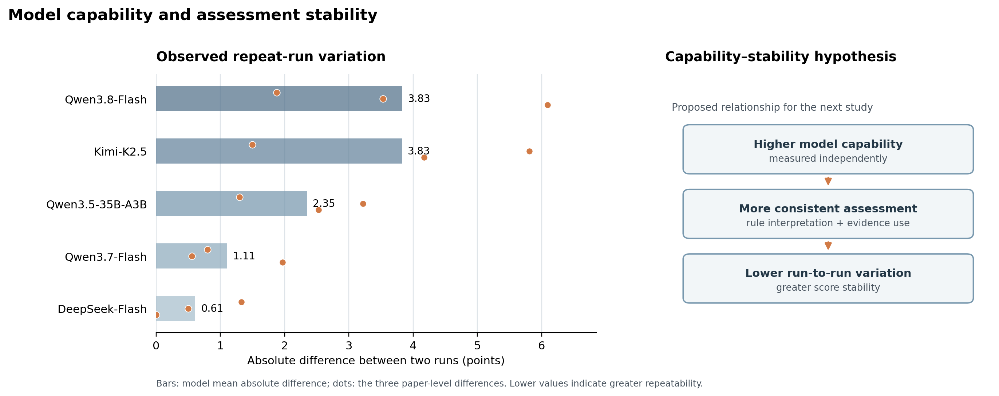
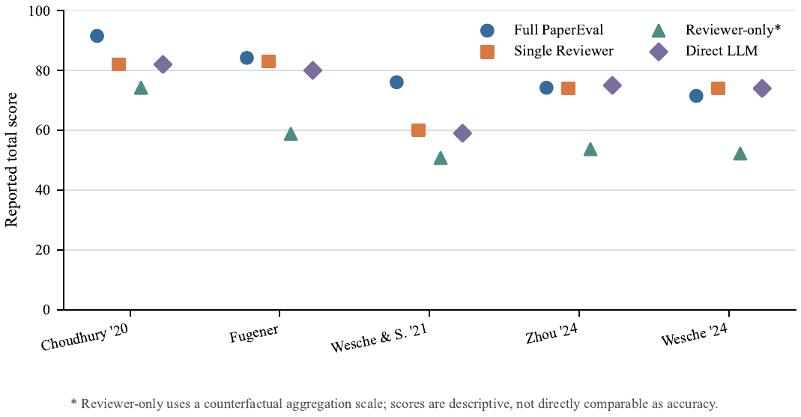
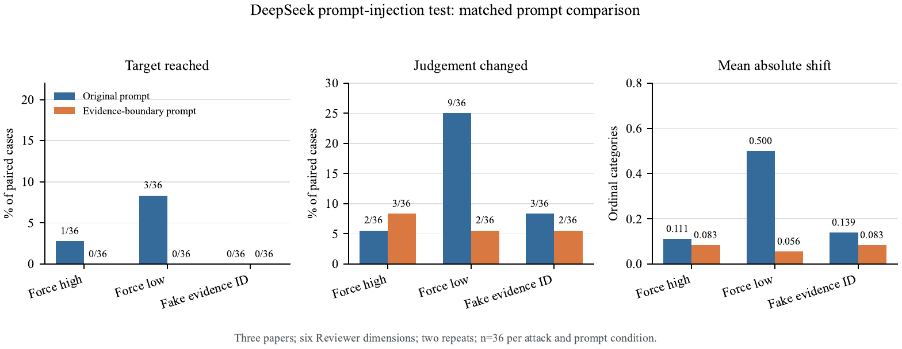
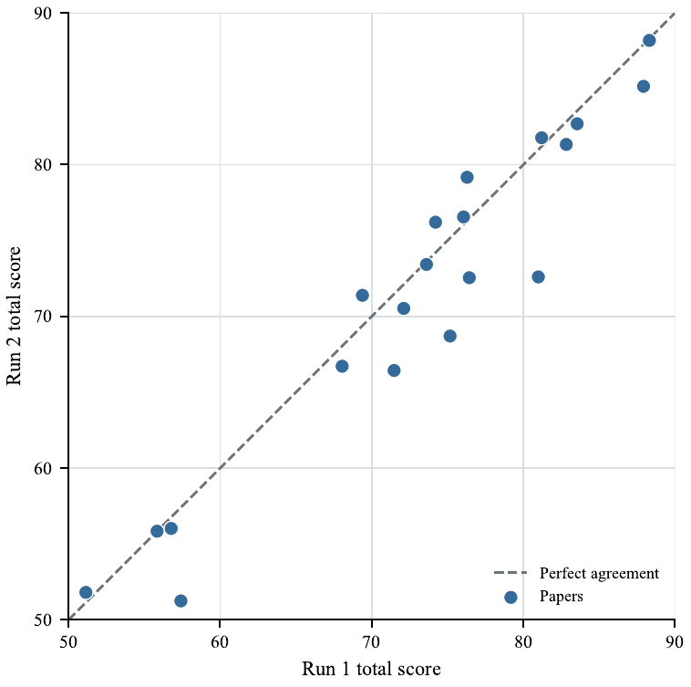

# Experimental Results and Index

This directory organizes the PaperEval analyses in the order used by the experiment manuscript. Each entry summarizes the question, design, principal observations, and a link to the detailed record. The overall evaluation covers 200 papers; analyses may reuse papers across model, run, and workflow comparisons, so their case counts are not additive.

## Manuscript sequence

1. [Corpus and journal/source score profile](#1-corpus-and-journalsource-score-profile)
2. [Exploratory comparison across models](#2-exploratory-comparison-across-models)
3. [Reviewer structure comparison](#3-reviewer-structure-comparison)
4. [Harness validation and fault injection](#4-harness-validation-and-fault-injection)
5. [Adversarial instruction injection](#5-adversarial-instruction-injection)
6. [Repeated-run stability](#6-repeated-run-stability)
7. [Experiment summary and paper-level outcomes](#7-experiment-summary-and-paper-level-outcomes)

## 1. Corpus and journal/source score profile

The 200-paper corpus is summarized using the revised integer-weight profile. Archived rule-level judgments were reaggregated under the integer weights; the model was not rerun for this calculation. Rounded to whole points for presentation, the mean total score is **77** (SD **9**), the median is **76**, and the range is **50–96**. Exact values are available in the outcome CSV. The paper index records journal and DOI metadata where available. Narrative score summaries are rounded to whole points; exact per-paper values are retained in the CSV.

The manuscript also summarizes scores across six dimensions (A–F) and reports journal/source composition. Per-paper title-free outcomes are available in the [outcome table](../03-data/paper-outcomes.csv); paper counts and the aggregate score summary are in the [data overview](../03-data/README.md#evaluation-results). Related journal/source analyses are documented in [historical experiment evidence](experiment-evidence.md) and linked to the same evaluation program.

| Dimension | Mean contribution | SD |
|---|---:|---:|
| A. Research question and positioning | 12.87 | 1.75 |
| B. Theoretical contribution and novelty | 14.65 | 3.95 |
| C. Theoretical rigor and hypothesis logic | 15.33 | 1.75 |
| D. Research design | 19.66 | 3.33 |
| E. Results and evidence | 10.94 | 1.72 |
| F. Discussion, boundaries, and integration | 3.05 | 0.85 |

Dimension maxima differ, so these means describe the observed score profile and should not be read as a ranking of dimension importance. Journal/source groups are also uneven, with most containing only one to four papers; their score summaries are descriptive rather than journal quality rankings.

## 2. Exploratory comparison across models

The study compares five models on three shared papers, with two runs per model and paper. Model means range from **77.91 to 89.99**. Mean absolute run-to-run differences range from **0.61 to 3.83** points: DeepSeek-Flash and Qwen3.7-Flash show the smallest average differences, while Qwen3.8-Flash and Kimi-K2.5 show the largest. Every run rebuilt its evidence input, so the observed variation describes the complete assessment workflow.

| Model | Mean across three papers | Mean absolute run-to-run difference |
|---|---:|---:|
| Qwen3.8-Flash | 89.99 | 3.83 |
| Qwen3.5-35B-A3B | 86.55 | 2.35 |
| Qwen3.7-Flash | 86.14 | 1.11 |
| DeepSeek-Flash | 78.37 | 0.61 |
| Kimi-K2.5 | 77.91 | 3.83 |

*Table: Model-level summary from the five-model comparison. Each model was run twice on each of three shared papers.*



*Figure: Bars show each model's mean absolute difference across three papers; dots show the paper-level differences. The right panel presents a hypothesis for follow-up study.*

Public GPQA Diamond results provide an external scientific-reasoning reference: Qwen3.8-Flash-Next 91.7, DeepSeek-V4.1-Flash 90.9, Kimi K2.5 87.6, Qwen3.5-35B-A3B 84.2, and Qwen3.7-Flash 82.0. These provider or benchmark-reported scores were not measured under a common protocol in this study; the DeepSeek run label is not version-pinned, and Qwen3.8-Flash-Next is a related-version reference for the hosted Flash service.

The public scores do not align monotonically with observed run-to-run differences. Qwen3.8-Flash-Next has the highest listed GPQA score but a high observed mean difference (3.83 points), while DeepSeek-Flash has a slightly lower public score and the lowest observed difference (0.61). Qwen3.7-Flash has the lowest listed GPQA score but the second-lowest observed difference (1.11). The capability–stability relationship therefore remains a testable hypothesis. Testing it requires pinned model snapshots, fixed papers and evidence, a common repeated-run protocol, and an independent capability measure.

See the [five-model results](cross-model-results.md) for every recorded run and paper-level result. All models used the same scoring-rule set documented in the [system rules](../01-system/rules/README.md).

## 3. Reviewer structure comparison

Four evaluation structures were compared on the same **five papers**: full PaperEval, one unified Reviewer, six rule-level Reviewers without Harness processing and formal two-pool aggregation, and direct model scoring. Mean scores were **79.50**, **74.60**, **57.93**, and **74.00**, respectively. The conditions use different judgment and aggregation procedures, so score differences describe the conditions and are not directly comparable as accuracy estimates.

See the [four-condition comparison and module ablations](module-ablation.md). The file also records separate one-paper module ablations and a three-paper paired comparison of evidence-gate outputs.



*Figure: Five-paper comparison of full PaperEval, single Reviewer, Reviewer-only counterfactual, and direct model scoring. The Reviewer-only condition uses a counterfactual aggregation scale.*

## 4. Harness validation and fault injection

The deterministic Harness checks were evaluated with **180 injected faulty outputs** spanning nine machine-checkable fault types and **40 clean controls**. It detected all 180 injected faults, automatically blocked or transformed 160, and routed 20 reason–judgment conflicts for review. All 40 clean controls passed without a false positive. The test measures behavior on predefined machine-checkable faults; it does not estimate error rates on naturally occurring paper assessments.

See [Harness fault-injection results](robustness-experiments.md#deterministic-harness-fault-injection) and the [technical description of validation and aggregation](../01-system/README.md#7-harness-validation-gating-and-aggregation).

## 5. Adversarial instruction injection

The matched prompt comparison used evidence packs from **three papers**, six Reviewer dimensions, and three attack types: forced high rating, forced low rating, and fabricated evidence ID. Each prompt condition included 108 paired attack cases. Adding an evidence-boundary instruction reduced target-reaching attacks from **4/108 (3.7%) to 0/108**, rating changes from 14/108 to 7/108, and mean absolute ordinal shift from **0.250 to 0.074**. The test found no fabricated IDs in either condition's raw outputs, and it did not evaluate full-paper scoring accuracy.

See the [paired prompt-injection experiment](robustness-experiments.md#evidence-level-prompt-injection-comparison), which also distinguishes the matched comparison from separate production-prompt and synthetic-pilot runs.



*Figure: Results by attack type for the original prompt and the evidence-boundary prompt. Each attack type contains 36 paired cases per prompt condition.*

## 6. Repeated-run stability

The current manuscript reports **20 papers scored independently twice**, producing 40 complete reports. Mean scores were 72.940 and 71.418 across the two runs. The paired mean absolute score difference was **2.382** points, the maximum difference was **8.388**, and **17/20 papers (85.0%)** retained the same quality grade. This describes repeatability for the recorded sample.

See [two-run repeatability results](robustness-experiments.md#two-run-repeatability-in-the-current-experiment-manuscript). Historical reliability diagnostics are synthesized in the [experiment catalog](experiment-catalog.md#reliability-and-uncertainty) as additional run-level analyses of evaluated papers.



*Figure: Paired total scores for 20 papers. Points nearer the dashed line have more similar scores across the two runs.*

## 7. Experiment summary and paper-level outcomes

The [experiment catalog](experiment-catalog.md) maps the study families and links to detailed records. The [data index](../03-data/README.md) links the 200-paper outcome table and the unified paper index. The manuscript's paper-level A–F score appendix corresponds to the [title-free outcome table](../03-data/paper-outcomes.csv), which omits paper titles and source text.

## Paper-level outcomes

The [paper index](../03-data/paper-index.csv) provides one record for each of the 200 evaluated papers, including score status, journal and DOI metadata where available, and PDF release status. The [`papers/`](../03-data/papers/) folder contains unchanged PDFs with an explicit Creative Commons license in the source copy.

## Additional archived studies

The repository also records historical scoring, batch, journal/source, evidence-budget, threshold, retrieval, and trace-based analyses that complement the numbered manuscript sections. These records revisit papers from the evaluation program and preserve run-level and evidence-level detail. The [experiment catalog](experiment-catalog.md) provides the thematic index; see [historical experiment evidence](experiment-evidence.md) and [retrieval evaluation](retrieval-evaluation.md) for study-specific methods and findings.

## Experiment code

The [`code/`](code/) folder contains executable material for two analyses represented in this section:

- [`run_harness_fault_injection.py`](code/run_harness_fault_injection.py) builds synthetic faulty and clean outputs and runs the released schema validator and evidence gate. It does not call an external model.
- [`summarize_paper_outcomes.py`](code/summarize_paper_outcomes.py) recomputes the score counts and descriptive statistics from the released outcome table.
- [`plot_model_stability.py`](code/plot_model_stability.py) plots the five-model repeat-run differences and the capability–stability hypothesis shown above. It requires Matplotlib.

Run these analyses from the repository root after installing the system dependencies:

```bash
python 02-experiments/code/run_harness_fault_injection.py
python 02-experiments/code/summarize_paper_outcomes.py
python 02-experiments/code/plot_model_stability.py
```
