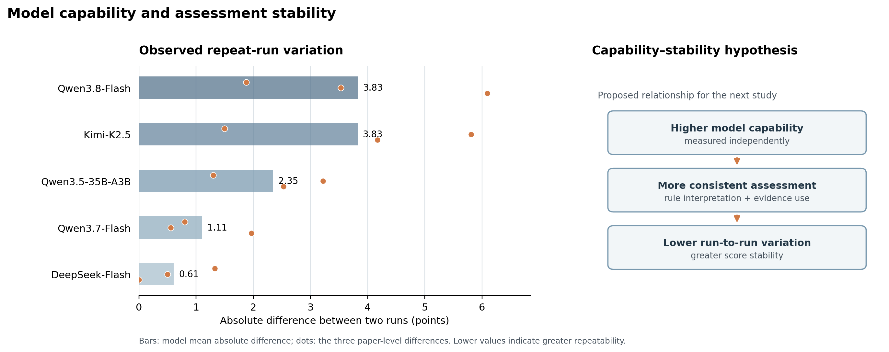

# Exploratory Comparison Across Five Models

## Study design

The study compared five models on three shared papers, with two runs for each paper–model pair (30 scores in total). All models used the same scoring-rule set. Each run rebuilt the paper evidence and repeated external-literature retrieval, so the results describe stability across the full assessment workflow.

## Results by paper and model

Scores are on a 0–100 scale. The run difference is the absolute difference between the two recorded runs for that paper–model pair.

| Paper | Model | Run 1 | Run 2 | Mean | Absolute run difference |
|---|---|---:|---:|---:|---:|
| Mikalef and Gupta (2021) | Qwen3.8-Flash | 82.98 | 84.86 | 83.92 | 1.88 |
| Mikalef and Gupta (2021) | Qwen3.5-35B-A3B | 77.77 | 76.47 | 77.12 | 1.30 |
| Mikalef and Gupta (2021) | Qwen3.7-Flash | 79.73 | 78.93 | 79.33 | 0.80 |
| Mikalef and Gupta (2021) | DeepSeek-Flash | 68.05 | 66.72 | 67.38 | 1.33 |
| Mikalef and Gupta (2021) | Kimi-K2.5 | 74.45 | 72.95 | 73.70 | 1.50 |
| Wesche and Sonderegger (2021) | Qwen3.8-Flash | 89.59 | 93.13 | 91.36 | 3.53 |
| Wesche and Sonderegger (2021) | Qwen3.5-35B-A3B | 91.05 | 87.83 | 89.44 | 3.22 |
| Wesche and Sonderegger (2021) | Qwen3.7-Flash | 85.70 | 85.14 | 85.42 | 0.56 |
| Wesche and Sonderegger (2021) | DeepSeek-Flash | 76.06 | 76.56 | 76.31 | 0.50 |
| Wesche and Sonderegger (2021) | Kimi-K2.5 | 79.80 | 73.98 | 76.89 | 5.81 |
| Yan et al. (2024) | Qwen3.8-Flash | 97.75 | 91.66 | 94.70 | 6.09 |
| Yan et al. (2024) | Qwen3.5-35B-A3B | 94.38 | 91.84 | 93.11 | 2.53 |
| Yan et al. (2024) | Qwen3.7-Flash | 94.66 | 92.68 | 93.67 | 1.97 |
| Yan et al. (2024) | DeepSeek-Flash | 91.42 | 91.42 | 91.42 | 0.00 |
| Yan et al. (2024) | Kimi-K2.5 | 81.06 | 85.23 | 83.15 | 4.17 |

## Model-level summary

| Model | Mean across three papers | Mean absolute run difference |
|---|---:|---:|
| Qwen3.8-Flash | 89.99 | 3.83 |
| Qwen3.5-35B-A3B | 86.55 | 2.35 |
| Qwen3.7-Flash | 86.14 | 1.11 |
| DeepSeek-Flash | 78.37 | 0.61 |
| Kimi-K2.5 | 77.91 | 3.83 |

## Interpretation

Across these three papers, the model-level means span 12.08 points, from 77.91 for Kimi-K2.5 to 89.99 for Qwen3.8-Flash. The paper-level ordering is the same across all five models: Yan et al. (2024) receives the highest mean, followed by Wesche and Sonderegger (2021), then Mikalef and Gupta (2021). This shared ordering describes only these three papers.

DeepSeek-Flash has the smallest model-level mean absolute difference (0.61), followed by Qwen3.7-Flash (1.11). Qwen3.8-Flash and Kimi-K2.5 have the largest averages (3.83 each). The largest paper-level difference is 6.09 for Qwen3.8-Flash on Yan et al. (2024); the smallest is 0.00 for DeepSeek-Flash on the same paper.

## Public capability reference and interpretation

We use GPQA Diamond as an external reference for scientific reasoning capability. It is not a direct measure of paper-assessment skill. The publicly reported scores for the corresponding model releases are:

| Model release | GPQA Diamond | Public source |
|---|---:|---|
| Qwen3.8-Flash-Next | 91.7 | [Qwen model card](https://huggingface.co/Qwen/Qwen3.8-Flash-Next-FP8) |
| DeepSeek-V4.1-Flash | 90.9 | [DeepSeek API updates](https://api-docs.deepseek.com/updates/) |
| Kimi K2.5 | 87.6 | [Moonshot technical report](https://github.com/MoonshotAI/Kimi-K2.5) |
| Qwen3.5-35B-A3B | 84.2 | [Qwen model card](https://huggingface.co/Qwen/Qwen3.5-35B-A3B-FP8) |
| Qwen3.7-Flash | 82.0 | [Epoch AI model evaluation](https://epoch.ai/models/qwen3-7-flash) |

The public results were reported by model providers or an external benchmark source under evaluation settings that this study did not control. The DeepSeek-Flash run label does not identify a versioned snapshot, so the current DeepSeek-V4.1-Flash score cannot be confirmed as the score for the historical endpoint used in our runs. Qwen's public Qwen3.8 score is for Flash-Next, the model underlying the hosted Flash service, and serves as a related-version reference rather than an exact rerun of that endpoint.

The comparison does not show a monotonic capability–stability relationship. Qwen3.8-Flash-Next has the highest listed GPQA score (91.7) but one of the largest observed run-to-run differences (3.83 points), tied with Kimi K2.5 (87.6; 3.83). DeepSeek-Flash has a slightly lower external score reference (90.9) and the smallest observed difference (0.61). Qwen3.7-Flash has the lowest listed score (82.0), yet the second-smallest observed difference (1.11). These five observations do not support a simple claim that greater general capability yields more stable paper scores. Because the published benchmark protocols and the historical model snapshots are not fully aligned, this comparison is exploratory and does not estimate a capability–stability correlation or establish causality.

The capability–stability relationship remains a testable hypothesis. A follow-up study will pin model snapshots, hold papers and evidence inputs constant, use a common repeated-run protocol, and measure capability independently before testing whether it predicts scoring stability.

The full experiment sequence is indexed in the [experiment results and index](README.md#manuscript-sequence). The single expert-calibrated scoring-rule set is documented in the [system rules](../01-system/rules/README.md).
