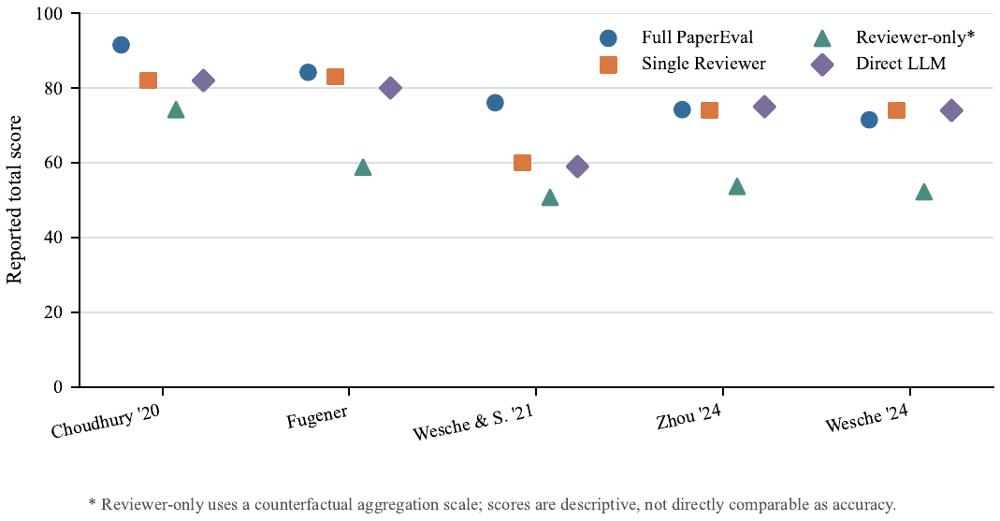
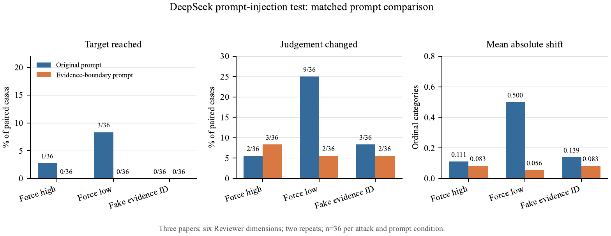
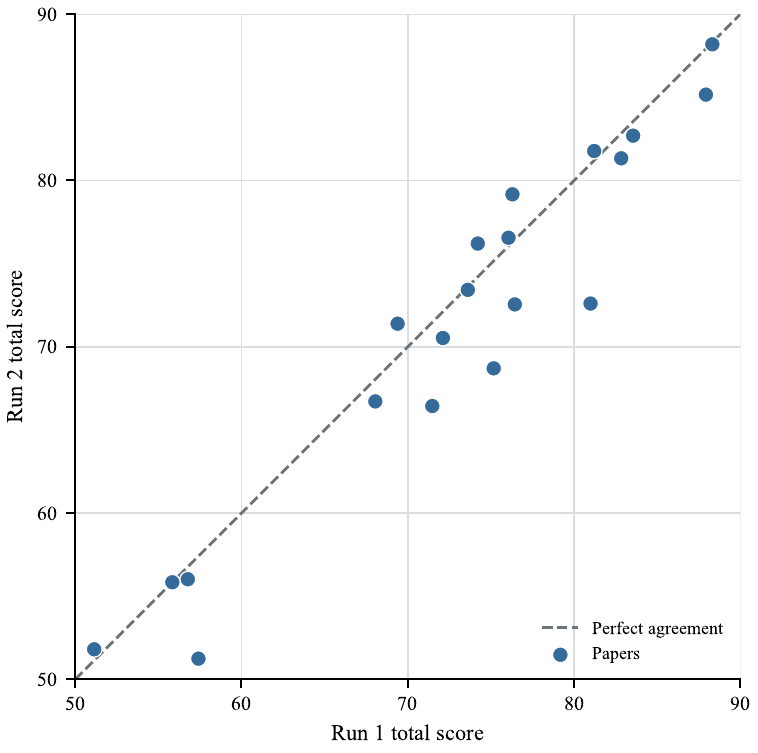

# Experimental Results and Index

This directory organizes the PaperEval experiments in the order used by the current experiment manuscript. Each entry summarizes the question, sample, principal observations, and a link to the detailed record. Samples differ across studies and may overlap; do not add their sample sizes to infer a project-wide number of unique papers.

## Manuscript sequence

1. [Corpus and journal/source score profile](#1-corpus-and-journalsource-score-profile)
2. [Exploratory comparison across models](#2-exploratory-comparison-across-models)
3. [Reviewer structure comparison](#3-reviewer-structure-comparison)
4. [Harness validation and fault injection](#4-harness-validation-and-fault-injection)
5. [Adversarial instruction injection](#5-adversarial-instruction-injection)
6. [Repeated-run stability](#6-repeated-run-stability)
7. [Experiment summary and paper-level outcomes](#7-experiment-summary-and-paper-level-outcomes)

## 1. Corpus and journal/source score profile

PaperEval completed scoring for **144 papers**. Two additional unique papers were blocked before scoring by PDF parsing. Across the 144 completed reports, the mean total score was **76.46** (SD 7.64), the median was **76.19**, and the range was **49.63–95.78**. These are descriptive scores for the audited corpus and run configuration.

The released paper-level record also includes **54 additional distinct papers** scored with the same model and calibrated criteria. Together with the primary audit, this gives **198 scored papers** across the project record; the 144-paper primary-audit statistics above remain a separate result. The supplementary set has a mean of **77.00** (SD 10.72), a median of **78.18**, and a range of **53.87–93.53**. Its source samples and journal metadata are indexed in the [supplementary paper index](../04-data/supplementary-paper-index.csv).

| Supplementary sample source | Scored papers |
|---|---:|
| Multi-journal expansion study | 25 |
| Journal comparison study | 19 (10 Journal of Business Research; 9 Management Science) |
| Management and AI working-paper sample | 4 |
| Theory-focused repeat sample | 3 |
| Theory-focused verification sample | 2 |
| Stratified sample | 1 |
| **Total additional papers** | **54** |

Across the supplementary set, journal metadata identifies 13 Management Science papers and 10 Journal of Business Research papers, alongside papers from other journals. Six records have no venue identified in the available source materials; see the index for paper-level DOI and venue fields.

The manuscript also summarizes scores across six dimensions (A–F) and reports journal/source composition. Per-paper title-free outcomes are available in the [outcome table](../04-data/paper-outcomes.csv); corpus counts and the aggregate score summary are in the [data overview](../04-data/README.md#scored-paper-counts). Related journal/source analyses are documented in [historical experiment evidence](experiment-evidence.md) and linked to the same broader evaluation program.

| Dimension | Mean contribution | SD |
|---|---:|---:|
| A. Research question and positioning | 12.61 | 1.71 |
| B. Theoretical contribution and novelty | 14.69 | 3.69 |
| C. Theoretical rigor and hypothesis logic | 15.09 | 1.58 |
| D. Research design | 19.67 | 2.72 |
| E. Results and evidence | 11.05 | 1.10 |
| F. Discussion, boundaries, and integration | 3.21 | 0.77 |

Dimension maxima differ, so these means describe the observed score profile and should not be read as a ranking of dimension importance. Journal/source groups are also uneven, with most containing only one to four papers; their score summaries are descriptive rather than journal quality rankings.

## 2. Exploratory comparison across models

The current manuscript compares five models on three shared papers, with two recorded runs per model and paper. Model means range from **77.91 to 89.99**; average absolute differences between repeated runs range from **0.61 to 3.83** points. The runs re-extracted evidence and repeated external retrieval, so differences combine model and evidence variation. The findings are descriptive and do not establish model accuracy or general superiority.

| Model | Mean across three papers | Mean absolute run-to-run difference |
|---|---:|---:|
| Qwen3.8-Flash | 89.99 | 3.83 |
| Qwen3.5-35B-A3B | 86.55 | 2.35 |
| Qwen3.7-Flash | 86.14 | 1.11 |
| DeepSeek-Flash | 78.37 | 0.61 |
| Kimi-K2.5 | 77.91 | 3.83 |

*Table: Model-level summary from the five-model comparison. Each model was run twice on each of three shared papers.*

See the [five-model results](cross-model-results.md) for every recorded run and paper-level result. All models used the same scoring-rule set documented in the [system rules](../02-system/rules/README.md).

## 3. Reviewer structure comparison

Four evaluation structures were compared on the same **five papers**: full PaperEval, one unified Reviewer, six rule-level Reviewers without Harness processing and formal two-pool aggregation, and direct model scoring. Mean scores were **79.50**, **74.60**, **57.93**, and **74.00**, respectively. The conditions use different judgment and aggregation procedures, so score differences describe the conditions and are not directly comparable as accuracy estimates.

See the [four-condition comparison and module ablations](module-ablation.md). The file also records separate one-paper module ablations and a three-paper paired comparison of evidence-gate outputs.



*Figure: Five-paper comparison of full PaperEval, single Reviewer, Reviewer-only counterfactual, and direct model scoring. The Reviewer-only condition uses a counterfactual aggregation scale.*

## 4. Harness validation and fault injection

The deterministic Harness checks were evaluated with **180 injected faulty outputs** spanning nine machine-checkable fault types and **40 clean controls**. It detected all 180 injected faults, automatically blocked or transformed 160, and routed 20 reason–judgment conflicts for review. All 40 clean controls passed without a false positive. The test measures behavior on predefined machine-checkable faults; it does not estimate error rates on naturally occurring paper assessments.

See [Harness fault-injection results](robustness-experiments.md#deterministic-harness-fault-injection) and the [technical description of validation and aggregation](../02-system/README.md#7-harness-validation-gating-and-aggregation).

## 5. Adversarial instruction injection

The matched prompt comparison used evidence packs from **three papers**, six Reviewer dimensions, and three attack types: forced high rating, forced low rating, and fabricated evidence ID. Each prompt condition included 108 paired attack cases. Adding an evidence-boundary instruction reduced target-reaching attacks from **4/108 (3.7%) to 0/108**, rating changes from 14/108 to 7/108, and mean absolute ordinal shift from **0.250 to 0.074**. The test found no fabricated IDs in either condition's raw outputs, and it did not evaluate full-paper scoring accuracy.

See the [paired prompt-injection experiment](robustness-experiments.md#evidence-level-prompt-injection-comparison), which also distinguishes the matched comparison from separate production-prompt and synthetic-pilot runs.



*Figure: Results by attack type for the original prompt and the evidence-boundary prompt. Each attack type contains 36 paired cases per prompt condition.*

## 6. Repeated-run stability

The current manuscript reports **20 papers scored independently twice**, producing 40 complete reports. Mean scores were 72.940 and 71.418 across the two runs. The paired mean absolute score difference was **2.382** points, the maximum difference was **8.388**, and **17/20 papers (85.0%)** retained the same quality grade. This describes repeatability for the recorded sample.

See [two-run repeatability results](robustness-experiments.md#two-run-repeatability-in-the-current-experiment-manuscript). Historical reliability diagnostics are synthesized in the [experiment catalog](experiment-catalog.md#reliability-and-uncertainty) as additional run-level analyses of evaluated papers.



*Figure: Paired total scores for 20 papers. Points nearer the dashed line have more similar scores across the two runs.*

## 7. Experiment summary and paper-level outcomes

The [experiment catalog](experiment-catalog.md) maps the study families and links to detailed records. The [data index](../04-data/README.md) links the primary audit, supplementary score set, and title-free outcomes. The manuscript's paper-level A–F score appendix corresponds to the [title-free outcome table](../04-data/paper-outcomes.csv), which omits paper titles and source text.

## Supplementary scored papers

The 54 additional papers are distinct by source-PDF SHA-256 hash and do not duplicate the primary corpus files. The [supplementary index](../04-data/supplementary-paper-index.csv) maps each record to its study source, journal and DOI when available, score, and PDF release status. Twenty PDFs with an explicit Creative Commons license are included in [`04-data/scored-papers/`](../04-data/scored-papers/); the remaining 34 records provide scores and metadata without a PDF copy.

## Additional archived studies

The repository also records historical scoring, batch, journal/source, evidence-budget, threshold, retrieval, and trace-based analyses that complement the numbered manuscript sections. These records revisit papers from the evaluation program and preserve run-level and evidence-level detail. The [experiment catalog](experiment-catalog.md) provides the thematic index; see [historical experiment evidence](experiment-evidence.md) and [retrieval evaluation](retrieval-evaluation.md) for study-specific methods and findings.

## Experiment code

The [`code/`](code/) folder contains executable material for two analyses represented in this section:

- [`run_harness_fault_injection.py`](code/run_harness_fault_injection.py) builds synthetic faulty and clean outputs and runs the released schema validator and evidence gate. It does not call an external model.
- [`summarize_paper_outcomes.py`](code/summarize_paper_outcomes.py) recomputes the score counts and descriptive statistics from the released outcome table.

Run both from the repository root after installing the system dependencies:

```bash
python 03-experiments/code/run_harness_fault_injection.py
python 03-experiments/code/summarize_paper_outcomes.py
```
